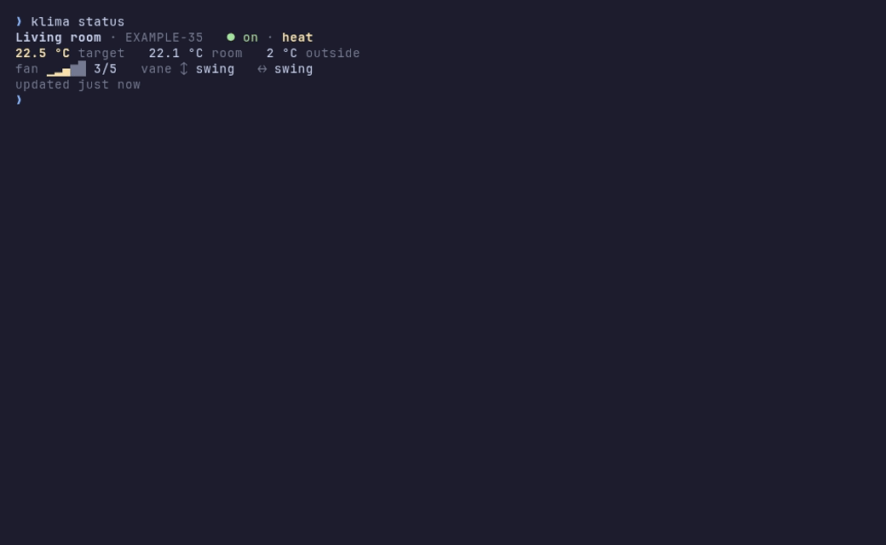

# melcloud-ac

`klima` is a terminal client for Mitsubishi Electric air conditioners on the classic MELCloud
service (`app.melcloud.com`): an interactive TUI and one-shot commands for the shell, on Linux,
macOS and Windows.

Unofficial project, not affiliated with Mitsubishi Electric. It talks to an undocumented API
and controls a real device on a real account.



## Install

Download the archive for your system from the
[latest release](https://github.com/lednifrolg/melcloud-ac/releases/latest) and put `klima` on
your PATH:

```sh
# Linux: x86_64-unknown-linux-musl or aarch64-unknown-linux-musl
# macOS: aarch64-apple-darwin (Apple silicon) or x86_64-apple-darwin (Intel)
target=x86_64-unknown-linux-musl
latest=https://github.com/lednifrolg/melcloud-ac/releases/latest/download
curl -fsSLO "$latest/klima-$target.tar.gz"
tar -xzf "klima-$target.tar.gz"
mkdir -p ~/.local/bin && install -m 755 "klima-$target/klima" ~/.local/bin/
```

On Windows, in PowerShell:

```powershell
# x86_64-pc-windows-msvc, or aarch64-pc-windows-msvc on ARM
$target = "x86_64-pc-windows-msvc"
$latest = "https://github.com/lednifrolg/melcloud-ac/releases/latest/download"
curl.exe -fsSLO "$latest/klima-$target.zip"
tar.exe -xf "klima-$target.zip"
$bin = "$env:LOCALAPPDATA\Programs\klima"
New-Item -ItemType Directory -Force $bin | Out-Null
Copy-Item "klima-$target\klima.exe" $bin
# Once: add it to your PATH, then open a new terminal
$path = [Environment]::GetEnvironmentVariable("Path", "User")
[Environment]::SetEnvironmentVariable("Path", "$path;$bin", "User")
```

The archives also hold shell completions and, except on Windows, man pages;
`klima completions <shell>` and `klima man <dir>` write the same files. In PowerShell, add
`klima completions powershell | Out-String | Invoke-Expression` to your `$PROFILE`. With the
GitHub CLI, this checks that the archive was built by this repository's release workflow (on
Windows, for the `.zip` and on one line):

```sh
gh attestation verify "klima-$target.tar.gz" --repo lednifrolg/melcloud-ac \
  --signer-workflow lednifrolg/melcloud-ac/.github/workflows/release.yml
```

From source, with a recent Rust:

```sh
cargo install --git https://github.com/lednifrolg/melcloud-ac --tag v0.1.0 --locked klima
```

## Usage

```sh
klima login            # asks for email and password; stores only the session
klima                  # the interactive TUI
klima status           # unit state (--json for scripts)
klima history          # room temperature and setting changes of the last 24 h (--since 7d)

klima on | off | toggle
klima temp 22.5        # or relative to the current target: +1, -0.5
klima mode cool        # heat, dry, cool, fan, auto
klima fan auto         # or a level from 1
klima vane --vertical swing --horizontal split
klima set --power on --mode heat --temp 21 --fan auto   # several changes, one command
```

A command waits until the unit confirms the new values; `--no-wait` returns right after
sending, `--dry-run` only shows what would be sent. `klima <command> --help` has the details.

In the TUI, pick a setting with `↑`/`↓` and change it with `←`/`→`, or use `+`/`-`, `m`, `f`,
`s` and `P` for temperature, mode, fan, swing and power; the mouse works too. Changes go out
together 3 seconds after the last one (`⏎` sends at once, `u` discards). `?` lists every key.

For window manager key bindings, see [Hyprland and Omarchy](docs/hyprland.md).

## Configuration

With several devices, pick one with `--device <name or ID>` or in `~/.config/klima/config.toml`
(`%APPDATA%\klima\config.toml` on Windows):

```toml
device = "Living room"
email = "user@example.com"   # offered by `klima login`
refresh_minutes = 10         # automatic refresh in the TUI, at least 5
animations = true            # spinning fan, swinging vanes, flashing digits in the TUI
```

The session, request ledger and history live in `~/.local/state/klima`, the last server
responses in `~/.cache/klima`; on Windows in `%LOCALAPPDATA%\klima\state` and `\cache`.
`KLIMA_HOME` puts config, state and cache in one directory. On Windows, the access rules of your
user profile keep these files private; a `KLIMA_HOME` outside it gets the rules of its directory.

## Request budget

MELCloud throttles a whole account for hours after too many requests, and repeated bad
passwords lock it behind a CAPTCHA. All running klima processes share one budget: at most 30
requests an hour, at least 60 seconds between reads of the same unit, no requests for 6 hours
after HTTP 429 (`klima unblock` lifts this locally) and no logins during a lockout. When a fresh
read is not possible, `klima status` shows the last known state and says why.

## Exit codes

| Code | Meaning |
|---|---|
| 0 | success |
| 1 | error talking to MELCloud, or a local file problem |
| 2 | wrong usage, e.g. an unknown or ambiguous device |
| 3 | stopped by the request budget, throttling or a login lockout |
| 4 | not logged in, or the session expired |
| 5 | sent, but the adapter did not confirm it or the unit reports other values |

## Development

`crates/melcloud` is the MELCloud API client, `crates/klima` the CLI and TUI. Tests run against
synthetic data and a mock server (`KLIMA_API_URL` points klima at it); never commit captured
server responses, credentials, session tokens or real device identifiers. Code, docs and commit
messages are in English. CI runs:

```sh
cargo fmt --all --check
cargo clippy --workspace --all-targets --locked -- -D warnings
cargo test --workspace --locked
RUSTDOCFLAGS="-D warnings" cargo doc --no-deps --workspace --locked
cargo deny check
```

## License

Licensed under either of [Apache License, Version 2.0](LICENSE-APACHE) or
[MIT license](LICENSE-MIT) at your option.
